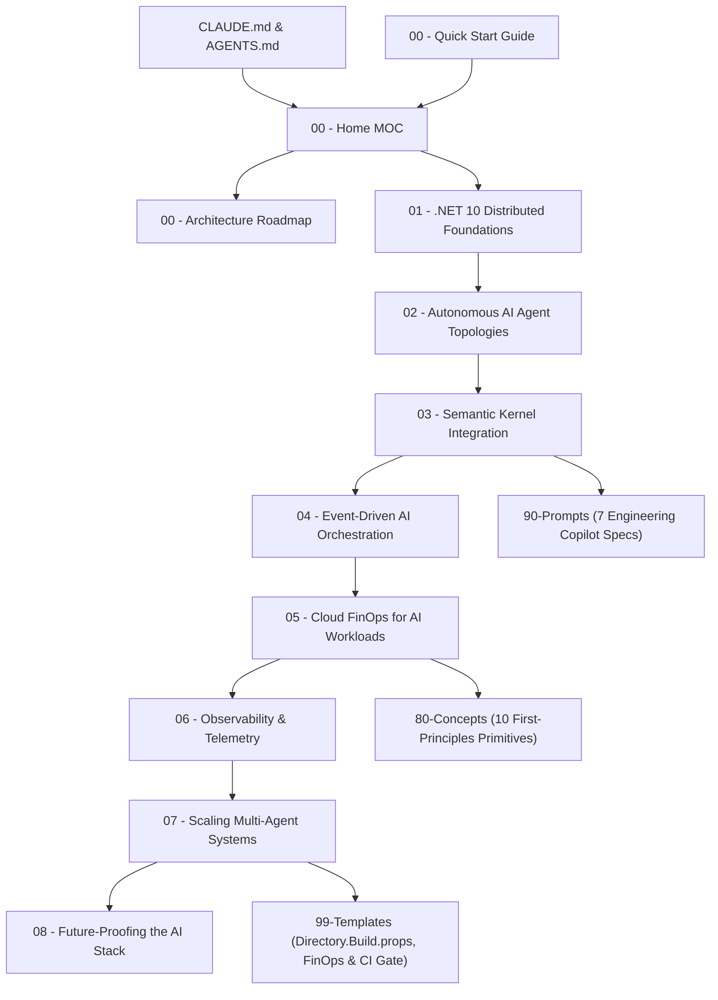

# Blueprint Starter .NET 10

> [!IMPORTANT]
> **Dual-Mode Engineering Knowledge System (Obsidian + Coding Agents):** Open this vault in **Obsidian** to navigate `36` interconnected `.NET 10` architecture blueprints, `80-Concepts` Zettelkasten primitives, and `.canvas` swimlanes—or point **Claude Code, Cursor, Copilot, or Antigravity** at root [[CLAUDE]] and [[AGENTS]] to audit your C# repositories automatically.
- **Local Agent Skill Index (`~/.claude/skills` & `.agent/skills`)**: [[SKILL|SKILL.md — Progressive Disclosure Routing Map]]

---

## 1. Executive Navigation & AI Agent Contracts

- **15-Minute Setup & Verification:** [[00 - Quick Start Guide]]
- **30-60-90 Day Production Rollout:** [[00 - Architecture Roadmap]]
- **Spatial Architecture Board:** [[00 - Visual Blueprint.canvas]]
- **Executable Coding-Agent Rules:** [[CLAUDE]] (Claude Code CLI) · [[AGENTS]] (Cursor / Copilot / Codex / Antigravity)
- **Engineering Copilot Index:** [[Prompt Library & AI Copilot]]

---

## 2. Core `.NET 10` Architecture & Operations Modules

### `01-Architecture` — Runtime & Agent Topologies
- [[01 - .NET 10 Distributed Foundations]] — Bounded `System.Threading.Channels`, GA `HybridCache` stampede protection, and non-allocating Polly v8 `ResiliencePipeline` hosts.
- [[02 - Autonomous AI Agent Topologies]] — Supervisor-Worker DAGs, Orleans/Actor choreographed meshes, and hop-bounded `SupervisorAgentOrchestrator`.

### `02-Implementation` — AI Kernel & Event Fabric
- [[03 - Semantic Kernel Integration]] — Native-AOT-clean `Microsoft.Extensions.AI` (`IChatClient`) bridged with Semantic Kernel `1.x` plugins and `JsonSerializerContext`.
- [[04 - Event-Driven AI Orchestration]] — Asynchronous MassTransit consumers, EF Core transactional outbox, and idempotent workflow step execution.

### `03-Operations` — FinOps & OpenTelemetry
- [[05 - Cloud FinOps for AI Workloads]] — In-flight integer micro-dollar token metering middleware, semantic cache short-circuiting, and tenant quota enforcement.
- [[06 - Observability & Telemetry]] — OpenTelemetry `gen_ai.*` distributed spans, `Meter` token/latency histograms, and inline PII redaction processors.

### `04-Growth-Scale` — Elastic Kubernetes & Provider Portability
- [[07 - Scaling Multi-Agent Systems]] — KEDA queue-lag autoscaling on Kubernetes, Workload Identity auth, and graceful `SIGTERM` in-flight drain.
- [[08 - Future-Proofing the AI Stack]] — Vendor-agnostic `IChatClient` tiered routing across Azure OpenAI (`DefaultAzureCredential`), Anthropic, and local Ollama/vLLM.

---

## 3. Atomic Zettelkasten Primitives (`80-Concepts/`)

- [[Concept 01 - Token Budget Leases]] — Pre-execution distributed token reservations preventing runaway agent spend.
- [[Concept 02 - Native AOT Kernel Wiring]] — Source-generated JSON schemas and reflection-free DI for fast cold starts.
- [[Concept 03 - Event Sourced Agent State]] — Immutable step logs enabling deterministic replay and time-travel debugging.
- [[Concept 04 - Ephemeral Swarm Allocation]] — Scoped DI lifetimes and linked `CancellationTokenSource` teardown for transient sub-agents.
- [[Concept 05 - Tiered Semantic Caching]] — Exact SHA-256 L1 (`HybridCache`) paired with cosine-threshold L2 vector lookup.
- [[Concept 06 - GenAI Distributed Tracing]] — W3C `traceparent` propagation across async channels and broker envelopes.
- [[Concept 07 - Speculative Tool Execution]] — Concurrent prefetching of idempotent read-only tools with branch cancellation.
- [[Concept 08 - Dynamic Token Backpressure]] — Adaptive `TokenBucketRateLimiter` driven by upstream `429 Retry-After` telemetry.
- [[Concept 09 - Model Cascade Routing]] — Confidence-gated escalation from low-cost SLMs to frontier reasoning models.
- [[Concept 10 - Tenant Memory Isolation]] — Cryptographic tenant partition filters across shared vector collections.

---

## 4. Engineering Copilots (`90-Prompts/`) & Production Runbooks (`99-Templates/`)

| Engineering Copilots (`90-Prompts/`) | Production Templates & Runbooks (`99-Templates/`) |
| :--- | :--- |
| [[Prompt 01 - System Architect]] | [[Template 01 - ADR Decision Record]] |
| [[Prompt 02 - Quality Risk Auditor]] | [[Template 02 - Unit Economics Matrix]] |
| [[Prompt 03 - Unit Economics CFO]] | [[Template 03 - Production Release Playbook]] |
| [[Prompt 04 - Verification Gate]] | [[SOP 01 - Weekly Sprint Protocol]] |
| [[Prompt 05 - Root Cause Debug]] | [[SOP 02 - Bottleneck Audit Matrix]] |
| [[Prompt 06 - Production Readiness & Chaos Review]] | [[SOP 03 - Scale & Automation Gate]] |

---

## 5. System Dependency Topology

