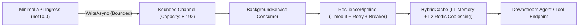

# 01 - .NET 10 Distributed Foundations

**Navigation:** [[00 - Home MOC]] | [[00 - Quick Start Guide]] | [[00 - Architecture Roadmap]] | [[CLAUDE]]

> [!IMPORTANT]
> **Architectural Mandate:** Distributed `.NET 10` hosts serving autonomous AI workloads must never expose unbounded in-memory queues, unpooled `HttpClient` sockets, or cache-stampede surfaces. Combine bounded `System.Threading.Channels`, GA `HybridCache` L1/L2 stampede coalescing, and non-allocating `Microsoft.Extensions.Resilience` (Polly v8) pipelines as your baseline service chassis.

---

## 1. Runtime Architecture & Core Pillars

High-concurrency `.NET 10` services coordinating LLM and tool workloads face bimodal latency distributions: microsecond L1 cache hits alongside multi-second downstream model calls. Four primitives keep memory and thread-pool latency deterministic:

1. **Structured Backpressure (`Channel.CreateBounded<T>`):** Bounds ingress queue depth explicitly (`BoundedChannelFullMode.Wait`), propagating TCP/HTTP `429` backpressure upstream rather than allowing `OutOfMemoryException` heap growth.
2. **Stampede-Proof Tiered Caching (`HybridCache`):** Coalesces concurrent misses for the same key into a single in-flight factory execution across local L1 memory and distributed L2 (`IDistributedCache` / Redis / Garnet), pairing naturally with [[Concept 05 - Tiered Semantic Caching]].
3. **Composable Resilience Pipelines (`ResiliencePipeline`):** Unifies jittered exponential retries, failure-ratio circuit breakers, and per-attempt timeouts using struct-based state transitions (`Microsoft.Extensions.Resilience`).
4. **Native AOT & `TimeProvider` Determinism:** Eliminates reflection-heavy startup overhead ([[Concept 02 - Native AOT Kernel Wiring]]) and injects `TimeProvider` so timeouts and circuit windows can be deterministically advanced in `xUnit` tests ([[Prompt 04 - Verification Gate]]).



---

## 2. Architecture Trade-Off Matrix

| Runtime Vector | Legacy Ad-Hoc `.NET` Approach | Hardened `.NET 10` Distributed Chassis |
| :--- | :--- | :--- |
| **Ingress Buffering** | `ConcurrentQueue<T>` or `Task.Run` per request (unbounded heap) | `Channel.CreateBounded<T>` with explicit capacity & `CancellationToken` |
| **Cache Stampede Control** | Manual `SemaphoreSlim` dictionaries (leak-prone under exceptions) | Built-in `HybridCache.GetOrCreateAsync` single-flight key coalescing |
| **Transient Fault Handling** | Scattered `try/catch` loops or legacy allocating Polly v7 wrappers | DI-registered Polly v8 `ResiliencePipeline` with jitter & telemetry |
| **Cold-Start & Working Set** | Reflection DI + runtime `JsonSerializer` metadata generation | `JsonSerializerContext` source generation (`PublishAot` compatible) |
| **Trace & Metric Attribution** | Manual stopwatch logs disconnected from upstream traces | Native `ActivitySource` + `Meter` wired into [[06 - Observability & Telemetry]] |

---

## 3. Production C# 14 Blueprint: `DistributedFoundationModule.cs`

```csharp
using System.Threading.Channels;
using Microsoft.Extensions.Caching.Hybrid;
using Microsoft.Extensions.DependencyInjection;
using Microsoft.Extensions.Hosting;
using Microsoft.Extensions.Logging;
using Polly;
using Polly.CircuitBreaker;
using Polly.Registry;
using Polly.Retry;

namespace ArchVault.DotNet10.Foundation;

public sealed record IngestionEnvelope(
    Guid CorrelationId,
    string TenantId,
    string TargetRoute,
    ReadOnlyMemory<byte> Payload,
    DateTimeOffset ReceivedAtUtc);

public static class DistributedFoundationExtensions
{
    public static IServiceCollection AddDistributedEngineFoundation(
        this IServiceCollection services,
        int channelCapacity = 8_192)
    {
        services.AddSingleton(TimeProvider.System);

        // 1. GA HybridCache (L1 in-process + L2 Redis/Garnet stampede protection)
        services.AddHybridCache(options =>
        {
            options.MaximumPayloadBytes = 4 * 1024 * 1024; // 4 MiB hard entry cap
            options.MaximumKeyLength = 512;
            options.DefaultEntryOptions = new HybridCacheEntryOptions
            {
                Expiration = TimeSpan.FromMinutes(15),
                LocalCacheExpiration = TimeSpan.FromMinutes(2)
            };
        });

        // 2. Bounded Channel enforcing deterministic backpressure
        services.AddSingleton<Channel<IngestionEnvelope>>(_ =>
            Channel.CreateBounded<IngestionEnvelope>(new BoundedChannelOptions(channelCapacity)
            {
                FullMode = BoundedChannelFullMode.Wait,
                SingleReader = false,
                SingleWriter = false,
                AllowSynchronousContinuations = false
            }));

        // 3. Non-allocating Polly v8 Resilience Pipeline
        services.AddResiliencePipeline("distributed-downstream", static (builder, context) =>
        {
            builder.TimeProvider = context.ServiceProvider.GetRequiredService<TimeProvider>();

            builder.AddRetry(new RetryStrategyOptions
            {
                MaxRetryAttempts = 3,
                BackoffType = DelayBackoffType.Exponential,
                UseJitter = true,
                Delay = TimeSpan.FromMilliseconds(80)
            });

            builder.AddCircuitBreaker(new CircuitBreakerStrategyOptions
            {
                FailureRatio = 0.5,
                SamplingDuration = TimeSpan.FromSeconds(15),
                MinimumThroughput = 20,
                BreakDuration = TimeSpan.FromSeconds(30)
            });

            builder.AddTimeout(TimeSpan.FromSeconds(8));
        });

        services.AddHostedService<BoundedIngestionWorker>();
        return services;
    }
}

public sealed class BoundedIngestionWorker(
    Channel<IngestionEnvelope> channel,
    HybridCache cache,
    ResiliencePipelineProvider<string> pipelineProvider,
    ILogger<BoundedIngestionWorker> logger) : BackgroundService
{
    protected override async Task ExecuteAsync(CancellationToken stoppingToken)
    {
        var pipeline = pipelineProvider.GetPipeline("distributed-downstream");
        await foreach (var envelope in channel.Reader.ReadAllAsync(stoppingToken))
        {
            await pipeline.ExecuteAsync(
                static async (state, ct) => await state.Self.ProcessEnvelopeAsync(state.Envelope, ct),
                (Self: this, Envelope: envelope),
                stoppingToken);
        }
    }

    private async ValueTask ProcessEnvelopeAsync(IngestionEnvelope envelope, CancellationToken ct)
    {
        var cacheKey = $"tenant:{envelope.TenantId}:msg:{envelope.CorrelationId:N}";

        // Static factory + explicit state tuple avoids closure heap allocations on every message
        var summary = await cache.GetOrCreateAsync(
            cacheKey,
            envelope,
            static async (env, token) =>
            {
                await Task.Yield();
                return $"Processed:{env.TargetRoute}:{env.Payload.Length}B";
            },
            cancellationToken: ct);

        logger.LogDebug("Dispatched {CorrelationId} -> {Summary}", envelope.CorrelationId, summary);
    }
}
```

---

## 4. Failure Modes & Production Guardrails

> [!WARNING]
> 1. **Closure Allocations in `HybridCache.GetOrCreateAsync`:** Capturing local variables inside the factory lambda allocates a new closure object on every lookup—even on L1 hits in hot loops. Always pass state explicitly as the second parameter with a `static` lambda.
> 2. **Synchronous Continuations Starving the Channel Writer:** Keep `AllowSynchronousContinuations = false` on `BoundedChannelOptions` so consumer continuations never hijack Minimal API Kestrel I/O threads.
> 3. **Missing Graceful Drain Window:** Pair `BackgroundService` loops with `HostOptions.ShutdownTimeout = TimeSpan.FromSeconds(45)` (see [[07 - Scaling Multi-Agent Systems]]) so Kubernetes pod termination drains active channel items cleanly.

---

## 5. Connected Architecture, Concepts & Runbooks

- **Downstream Agent & Event Layers:** [[02 - Autonomous AI Agent Topologies]] · [[03 - Semantic Kernel Integration]] · [[04 - Event-Driven AI Orchestration]]
- **Cost & Telemetry Enforcement:** [[05 - Cloud FinOps for AI Workloads]] · [[06 - Observability & Telemetry]] · [[08 - Future-Proofing the AI Stack]]
- **Zettelkasten Bridges:** [[Concept 01 - Token Budget Leases]] · [[Concept 02 - Native AOT Kernel Wiring]] · [[Concept 04 - Ephemeral Swarm Allocation]] · [[Concept 08 - Dynamic Token Backpressure]]
- **Templates, Prompts & SOPs:** [[Prompt 01 - System Architect]] · [[Template 01 - ADR Decision Record]] · [[Template 03 - Production Release Playbook]] · [[SOP 02 - Bottleneck Audit Matrix]] · [[SOP 03 - Scale & Automation Gate]] · [[00 - Visual Blueprint.canvas]]
