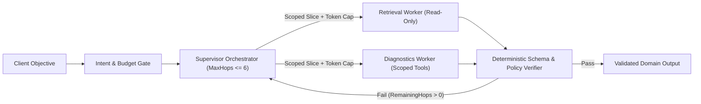

# 02 - Autonomous AI Agent Topologies

**Navigation:** [[00 - Home MOC]] | [[00 - Quick Start Guide]] | [[00 - Architecture Roadmap]] | [[AGENTS]]

> [!IMPORTANT]
> **Architectural Mandate:** Unconstrained peer-to-peer agent chat loops fail in production due to context-window pollution, cyclic delegation storms, and ambient privilege escalation. Structure enterprise `.NET 10` multi-agent systems around **hop-bounded Supervisor-Worker DAGs** or **event-choreographed actor meshes** with per-worker tool allowlists and explicit token budgets.

---

## 1. Enterprise Topology Taxonomy

| Topology Pattern | Control Flow | State Isolation | Ideal `.NET 10` Workload |
| :--- | :--- | :--- | :--- |
| **1. Supervisor-Worker DAG** | Deterministic root coordinator dispatches narrow sub-tasks | Workers receive projected context slices only | Incident triage, code review, structured document synthesis |
| **2. Choreographed Event Mesh** | Async CloudEvents over MassTransit / Service Bus ([[04 - Event-Driven AI Orchestration]]) | Durable saga state + outbox per consumer | Long-running multi-minute workflows & human approval gates |
| **3. Confidence Router-Ensemble** | Lightweight classifier / SLM routes to single specialist ([[Concept 09 - Model Cascade Routing]]) | Stateless single-hop execution | High-RPS support & FinOps-sensitive tenant workloads |



---

## 2. Memory Segregation Rules

Shared chat-history mutation across sub-agents degrades reasoning accuracy and leaks cross-tenant context ([[Concept 10 - Tenant Memory Isolation]]):

- **Ephemeral Worker Scratchpad:** Allocated inside an `AsyncServiceScope` ([[Concept 04 - Ephemeral Swarm Allocation]]) for a single sub-task and garbage-collected immediately upon step return.
- **Immutable Episodic Ledger:** Append-only sequence of `AgentStepCommitted` records ([[Concept 03 - Event Sourced Agent State]]) persisted outside worker memory.
- **System-of-Record Mutations:** Executed strictly via idempotent domain commands after deterministic schema verification passes.

---

## 3. Production C# 14 Blueprint: Hop- & Budget-Bounded `SupervisorAgentOrchestrator`

```csharp
using System.Diagnostics;

namespace ArchVault.DotNet10.AgentTopologies;

public sealed record AgentSubTask(
    Guid WorkflowId,
    string TenantId,
    string Intent,
    string ScopedContext,
    int RemainingTokenBudget,
    int HopIndex,
    int MaxHops = 6);

public sealed record WorkerStepOutcome(
    Guid WorkflowId,
    string WorkerId,
    bool Succeeded,
    string StructuredOutput,
    int InputTokens,
    int OutputTokens,
    string? FailureCode = null)
{
    public int TokensUsed => InputTokens + OutputTokens;
}

public interface IBoundedWorkerAgent
{
    string WorkerId { get; }
    bool CanHandle(string intent);
    ValueTask<WorkerStepOutcome> ExecuteStepAsync(AgentSubTask task, CancellationToken ct);
}

public sealed class SupervisorAgentOrchestrator(IEnumerable<IBoundedWorkerAgent> workers)
{
    private static readonly ActivitySource Telemetry = new("ArchVault.AgentTopology.Supervisor");
    private readonly IBoundedWorkerAgent[] _workers = workers.ToArray();

    public async Task<IReadOnlyList<WorkerStepOutcome>> ExecutePlanAsync(
        Guid workflowId,
        string tenantId,
        IReadOnlyList<(string Intent, string ScopedContext)> planSteps,
        int totalTokenCeiling,
        CancellationToken ct)
    {
        using var activity = Telemetry.StartActivity("invoke_agent supervisor_dag", ActivityKind.Internal);
        activity?.SetTag("gen_ai.operation.name", "invoke_agent");
        activity?.SetTag("workflow.id", workflowId.ToString());

        if (planSteps.Count > 6)
        {
            throw new InvalidOperationException($"Plan length ({planSteps.Count}) exceeds hard 6-hop DAG ceiling.");
        }

        var outcomes = new List<WorkerStepOutcome>(planSteps.Count);
        var consumedInputTokens = 0;
        var consumedOutputTokens = 0;

        for (var idx = 0; idx < planSteps.Count; idx++)
        {
            ct.ThrowIfCancellationRequested();
            var remaining = totalTokenCeiling - (consumedInputTokens + consumedOutputTokens);
            if (remaining <= 0)
            {
                activity?.SetStatus(ActivityStatusCode.Error, "WorkflowTokenCeilingReached");
                outcomes.Add(new WorkerStepOutcome(
                    workflowId, "supervisor", false, string.Empty, 0, 0, "TOKEN_CEILING_EXCEEDED"));
                break;
            }

            var (intent, contextSlice) = planSteps[idx];
            var worker = Array.Find(_workers, w => w.CanHandle(intent))
                ?? throw new InvalidOperationException($"No registered worker handles intent '{intent}'.");

            var outcome = await worker.ExecuteStepAsync(
                new AgentSubTask(workflowId, tenantId, intent, contextSlice, remaining, idx + 1),
                ct);

            consumedInputTokens += outcome.InputTokens;
            consumedOutputTokens += outcome.OutputTokens;
            outcomes.Add(outcome);

            if (!outcome.Succeeded)
            {
                activity?.SetStatus(ActivityStatusCode.Error, outcome.FailureCode);
                break;
            }
        }

        activity?.SetTag("gen_ai.usage.input_tokens", consumedInputTokens);
        activity?.SetTag("gen_ai.usage.output_tokens", consumedOutputTokens);
        activity?.SetTag("gen_ai.usage.total_tokens", consumedInputTokens + consumedOutputTokens);
        return outcomes;
    }
}
```

---

## 4. Anti-Patterns to Eliminate

> [!WARNING]
> - **Unbounded Conversational Group-Chat Loops:** Never allow two LLM agents to converse without a strictly monotonically decreasing `MaxHops` counter and hard token lease ([[Concept 01 - Token Budget Leases]]).
> - **Full Transcript Forwarding:** Passing a `32,000`-token parent transcript into five parallel workers multiplies input token burn by `5x`. Project only the required JSON fields into `ScopedContext`.
> - **Singleton Stateful Workers:** Holding mutable per-request fields on singleton `IBoundedWorkerAgent` instances causes cross-tenant data races under concurrent requests.

---

## 5. Connected Architecture, Concepts & Runbooks

- **Foundation & Kernel Integration:** [[01 - .NET 10 Distributed Foundations]] · [[03 - Semantic Kernel Integration]] · [[04 - Event-Driven AI Orchestration]]
- **FinOps, Telemetry & Scale:** [[05 - Cloud FinOps for AI Workloads]] · [[06 - Observability & Telemetry]] · [[07 - Scaling Multi-Agent Systems]] · [[08 - Future-Proofing the AI Stack]]
- **Zettelkasten Bridges:** [[Concept 02 - Native AOT Kernel Wiring]] · [[Concept 04 - Ephemeral Swarm Allocation]] · [[Concept 05 - Tiered Semantic Caching]] · [[Concept 07 - Speculative Tool Execution]]
- **Prompts & Governance:** [[Prompt Library & AI Copilot]] · [[Prompt 02 - Quality Risk Auditor]] · [[Prompt 04 - Verification Gate]] · [[Template 01 - ADR Decision Record]] · [[SOP 01 - Weekly Sprint Protocol]] · [[00 - Visual Blueprint.canvas]]
