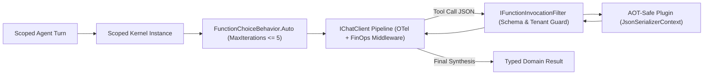

# 03 - Semantic Kernel Integration

**Navigation:** [[00 - Home MOC]] | [[00 - Quick Start Guide]] | [[00 - Architecture Roadmap]] | [[CLAUDE]]

> [!IMPORTANT]
> **2026 API Currency Rule:** Legacy `HandlebarsPlanner` and `StepwisePlanner` are deprecated in Semantic Kernel `1.x+`. Modern `.NET 10` applications unify on **`Microsoft.Extensions.AI` (`IChatClient`)** paired with Semantic Kernel native tool-calling (`FunctionChoiceBehavior.Auto`) bounded by explicit `MaximumIterationsPerRequest` and AOT-clean `JsonSerializerContext` schemas.

---

## 1. Deterministic Kernel & `IChatClient` Architecture

Semantic Kernel `1.x+` sits atop `Microsoft.Extensions.AI` abstractions rather than competing with them:

1. **Unified `IChatClient` Transport:** Underlying providers (Azure OpenAI, Anthropic, Ollama) register as `IChatClient` pipelines ([[08 - Future-Proofing the AI Stack]]), automatically feeding Semantic Kernel's chat and tool-execution loop.
2. **AOT-Safe Schema Marshaling (`JsonSerializerContext`):** Supplying a source-generated `JsonSerializerOptions` (`[JsonSerializable]`) when importing plugins prevents runtime reflection (`IL2026`/`IL3050`), enabling trim-clean deployment per [[Concept 02 - Native AOT Kernel Wiring]].
3. **Hard Invocation Filters (`IFunctionInvocationFilter` & `IAutoFunctionInvocationFilter`):** Enforces parameter length/pattern checks, tenant ownership, and loop-iteration caps (`<= 5` tool turns) before any enterprise microservice is touched.



---

## 2. Production C# 14 Blueprint: Native-AOT-Safe Kernel + Invocation Guardrail

```csharp
using System.ComponentModel;
using System.Text.Json;
using System.Text.Json.Serialization;
using Microsoft.Extensions.AI;
using Microsoft.Extensions.DependencyInjection;
using Microsoft.Extensions.Logging;
using Microsoft.SemanticKernel;

namespace ArchVault.DotNet10.AiKernel;

public sealed record LedgerBalanceDto(string AccountId, string Currency, decimal AvailableUsd);

[JsonSerializable(typeof(LedgerBalanceDto))]
[JsonSerializable(typeof(string))]
[JsonSerializable(typeof(CancellationToken))]
internal sealed partial class LedgerPluginJsonContext : JsonSerializerContext;

public static class SemanticKernelRegistration
{
    public static IServiceCollection AddEnterpriseSemanticKernel(this IServiceCollection services)
    {
        services.AddSingleton<IFunctionInvocationFilter, ParameterGuardrailFilter>();
        services.AddSingleton<IAutoFunctionInvocationFilter, IterationCeilingFilter>();
        services.AddScoped<FinancialLedgerPlugin>();

        // Kernel is ALWAYS Scoped or Transient — never Singleton — to prevent cross-request state bleed
        services.AddScoped<Kernel>( static sp =>
        {
            var builder = Kernel.CreateBuilder();
            builder.Services.AddSingleton(sp.GetRequiredService<ILoggerFactory>());
            builder.Services.AddSingleton(sp.GetRequiredService<IChatClient>());

            // Import plugin using source-generated JsonSerializerOptions for Native AOT safety
            var pluginInstance = sp.GetRequiredService<FinancialLedgerPlugin>();
#pragma warning disable SKEXP0120 // AOT JsonSerializerOptions plugin overload is marked experimental in SK 1.x
            builder.Plugins.AddFromObject(
                pluginInstance,
                jsonSerializerOptions: LedgerPluginJsonContext.Default.Options,
                pluginName: "FinancialLedger");
#pragma warning restore SKEXP0120

            var kernel = builder.Build();
            kernel.FunctionInvocationFilters.Add(sp.GetRequiredService<IFunctionInvocationFilter>());
            kernel.AutoFunctionInvocationFilters.Add(sp.GetRequiredService<IAutoFunctionInvocationFilter>());
            return kernel;
        });

        return services;
    }
}

public sealed class FinancialLedgerPlugin(ILogger<FinancialLedgerPlugin> logger)
{
    [KernelFunction("get_account_balance")]
    [Description("Reads the current settled USD balance for an authorized tenant account ID.")]
    public async Task<LedgerBalanceDto> GetAccountBalanceAsync(
        [Description("Alphanumeric account identifier (e.g. acct_0193a).")] string accountId,
        CancellationToken ct = default)
    {
        logger.LogInformation("Reading ledger balance for {AccountId}", accountId);
        await Task.Delay(5, ct);
        return new LedgerBalanceDto(accountId, "USD", 48_250.00m);
    }
}

public sealed class ParameterGuardrailFilter : IFunctionInvocationFilter
{
    public async Task OnFunctionInvocationAsync(
        Microsoft.SemanticKernel.FunctionInvocationContext context,
        Func<Microsoft.SemanticKernel.FunctionInvocationContext, Task> next)
    {
        if (context.Arguments.TryGetValue("accountId", out var raw) &&
            (raw?.ToString() is not { Length: > 3 and <= 32 } id || !id.All(c => char.IsLetterOrDigit(c) || c == '_')))
        {
            throw new ArgumentException("Rejected malformed accountId parameter in tool invocation.");
        }

        await next(context);
    }
}

public sealed class IterationCeilingFilter(ILogger<IterationCeilingFilter> logger) : IAutoFunctionInvocationFilter
{
    private const int MaxToolTurns = 5;

    public async Task OnAutoFunctionInvocationAsync(
        AutoFunctionInvocationContext context,
        Func<AutoFunctionInvocationContext, Task> next)
    {
        if (context.RequestSequenceIndex >= MaxToolTurns)
        {
            logger.LogWarning("Terminating auto-function loop at turn {Turn}", context.RequestSequenceIndex);
            context.Terminate = true;
            return;
        }

        await next(context);
    }
}
```

---

## 3. Critical Pitfalls & Operational Rules

> [!WARNING]
> 1. **Singleton `Kernel` Registration:** Registering `Kernel` as a singleton shares `Kernel.Data` and mutable plugin collections across concurrent HTTP/broker threads. Keep `Kernel` scoped per request/message ([[01 - .NET 10 Distributed Foundations]]).
> 2. **Unannotated Reflection Plugin Imports:** Calling `AddFromType<T>()` without a `JsonSerializerContext` triggers trim warnings (`IL2026`) under `PublishAot=true`. Always pass `LedgerPluginJsonContext.Default.Options`.
> 3. **Missing `HttpContext.RequestAborted` / Consumer `CancellationToken`:** Always thread cancellation into `GetChatMessageContentAsync` so disconnected clients immediately abort in-flight token generation ([[05 - Cloud FinOps for AI Workloads]]).

---

## 4. Connected Architecture, Concepts & Runbooks

- **Adjacent Layers:** [[02 - Autonomous AI Agent Topologies]] · [[04 - Event-Driven AI Orchestration]] · [[08 - Future-Proofing the AI Stack]]
- **Observability & Cost Controls:** [[05 - Cloud FinOps for AI Workloads]] · [[06 - Observability & Telemetry]] · [[07 - Scaling Multi-Agent Systems]]
- **Zettelkasten Bridges:** [[Concept 02 - Native AOT Kernel Wiring]] · [[Concept 03 - Event Sourced Agent State]] · [[Concept 05 - Tiered Semantic Caching]] · [[Concept 06 - GenAI Distributed Tracing]] · [[Concept 10 - Tenant Memory Isolation]]
- **Copilots & Templates:** [[Prompt Library & AI Copilot]] · [[Prompt 03 - Unit Economics CFO]] · [[Prompt 05 - Root Cause Debug]] · [[Template 01 - ADR Decision Record]] · [[Template 03 - Production Release Playbook]] · [[SOP 03 - Scale & Automation Gate]] · [[00 - Visual Blueprint.canvas]]
