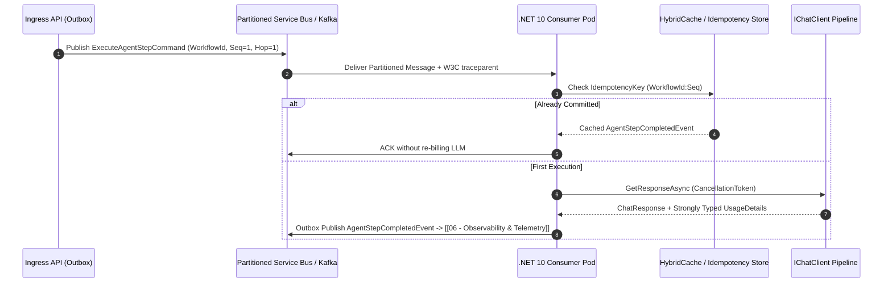

# 04 - Event-Driven AI Orchestration

**Navigation:** [[00 - Home MOC]] | [[00 - Quick Start Guide]] | [[00 - Architecture Roadmap]] | [[AGENTS]]

> [!IMPORTANT]
> **Asynchronous Backbone Rule:** Multi-step LLM workflows span `800 ms` to `45 seconds` per reasoning turn. Executing multi-agent chains synchronously over HTTP exhausts sockets and loses work on pod restarts. Decouple agent steps onto partitioned message brokers (Azure Service Bus, Kafka, RabbitMQ) using **MassTransit**, **deterministic idempotency keys**, and an **EF Core Transactional Outbox**.

---

## 1. Event-Driven Saga & Outbox Topology

1. **Idempotent Command Envelopes:** Every `ExecuteAgentStepCommand` carries a deterministic `IdempotencyKey = $"{WorkflowId:N}:{SequenceNumber}"` checked before invoking `IChatClient` so broker redeliveries never double-spend tokens ([[05 - Cloud FinOps for AI Workloads]]).
2. **Hop-Bounded Headers:** Propagate `HopCount` and W3C `traceparent` ([[Concept 06 - GenAI Distributed Tracing]]); reject any message exceeding `MaxHops = 8` directly to the quarantine queue.
3. **AOT-Clean Usage Extraction:** Read strongly typed `ChatResponse.Usage` (`InputTokenCount`, `OutputTokenCount`) from `Microsoft.Extensions.AI`—never `dynamic` runtime reflection—preserving full Native AOT compatibility ([[Concept 02 - Native AOT Kernel Wiring]]).



---

## 2. Synchronous HTTP vs Event-Driven Broker Comparison

| Engineering Dimension | Synchronous HTTP Chain | Partitioned Event-Driven Fabric (`.NET 10`) |
| :--- | :--- | :--- |
| **Pod Restart Resilience** | Active reasoning turns lost; client receives `502/504` | Broker redelivers unacknowledged step; prior steps hydrated from state |
| **Provider `429` Storm** | Cascading upstream timeouts across microservices | Consumer concurrency limiter + exponential backoff absorbs spike |
| **Duplicate Token Billing** | Client retries re-run entire multi-step chain | Step-level idempotency cache short-circuits already-completed steps |
| **Horizontal Elastic Scale** | CPU stays near `0%` while waiting on I/O (HPA blind) | KEDA scales replicas directly on broker queue lag ([[07 - Scaling Multi-Agent Systems]]) |

---

## 3. Production C# 14 Blueprint: Idempotent MassTransit Agent Step Consumer

```csharp
using System.Diagnostics;
using MassTransit;
using Microsoft.Extensions.AI;
using Microsoft.Extensions.Caching.Hybrid;
using Microsoft.Extensions.Logging;

namespace ArchVault.DotNet10.EventOrchestration;

public sealed record ExecuteAgentStepCommand(
    Guid WorkflowId,
    Guid StepId,
    int SequenceNumber,
    int HopCount,
    string TenantId,
    string SystemPrompt,
    string UserPayload);

public sealed record AgentStepCompletedEvent(
    Guid WorkflowId,
    Guid StepId,
    int SequenceNumber,
    string OutputText,
    long InputTokens,
    long OutputTokens);

public sealed class ExecuteAgentStepConsumer(
    IChatClient chatClient,
    HybridCache cache,
    ILogger<ExecuteAgentStepConsumer> logger) : IConsumer<ExecuteAgentStepCommand>
{
    private const int HardHopCeiling = 8;
    private static readonly ActivitySource Telemetry = new("ArchVault.EventOrchestration");

    public async Task Consume(ConsumeContext<ExecuteAgentStepCommand> context)
    {
        var msg = context.Message;
        using var activity = Telemetry.StartActivity("consume_agent_step", ActivityKind.Consumer);
        activity?.SetTag("workflow.id", msg.WorkflowId.ToString());
        activity?.SetTag("step.sequence", msg.SequenceNumber);

        if (msg.HopCount > HardHopCeiling)
        {
            logger.LogError("Quarantining workflow {WorkflowId}: HopCount {Hop} > {Ceiling}",
                msg.WorkflowId, msg.HopCount, HardHopCeiling);
            return; // Consume without re-publishing to break cyclic cascade
        }

        var idempotencyKey = $"idem:{msg.TenantId}:{msg.WorkflowId:N}:{msg.SequenceNumber}";

        var completedEvent = await cache.GetOrCreateAsync(
            idempotencyKey,
            (Chat: chatClient, Message: msg),
            static async (state, ct) =>
            {
                var messages = new List<ChatMessage>(2)
                {
                    new(ChatRole.System, state.Message.SystemPrompt),
                    new(ChatRole.User, state.Message.UserPayload)
                };

                var options = new ChatOptions
                {
                    Temperature = 0.2f,
                    MaxOutputTokens = 1_500
                };

                var response = await state.Chat.GetResponseAsync(messages, options, ct);
                var inputTok = response.Usage?.InputTokenCount ?? 0L;
                var outputTok = response.Usage?.OutputTokenCount ?? 0L;

                return new AgentStepCompletedEvent(
                    state.Message.WorkflowId,
                    state.Message.StepId,
                    state.Message.SequenceNumber,
                    response.Text,
                    inputTok,
                    outputTok);
            },
            cancellationToken: context.CancellationToken);

        await context.Publish(completedEvent, context.CancellationToken);
    }
}
```

---

## 4. Operational Failure Modes

> [!WARNING]
> - **Poison Messages Blocking Partition Heads:** Distinguish transient `HttpRequestException` / `429` errors (eligible for exponential jitter retry) from deterministic schema `JsonException` errors (route immediately to error queue).
> - **Dual-Write Split Brain:** Saving state to PostgreSQL and publishing to Service Bus without `AddEntityFrameworkOutbox<TDbContext>()` loses events when pods crash mid-commit.

---

## 5. Connected Architecture, Concepts & Runbooks

- **Core Runtime & Kernel:** [[01 - .NET 10 Distributed Foundations]] · [[02 - Autonomous AI Agent Topologies]] · [[03 - Semantic Kernel Integration]]
- **Operations & Elastic Scale:** [[05 - Cloud FinOps for AI Workloads]] · [[06 - Observability & Telemetry]] · [[07 - Scaling Multi-Agent Systems]] · [[08 - Future-Proofing the AI Stack]]
- **Zettelkasten Bridges:** [[Concept 03 - Event Sourced Agent State]] · [[Concept 04 - Ephemeral Swarm Allocation]] · [[Concept 06 - GenAI Distributed Tracing]] · [[Concept 07 - Speculative Tool Execution]]
- **Prompts & Runbooks:** [[Prompt 04 - Verification Gate]] · [[Prompt 06 - Production Readiness & Chaos Review]] · [[Template 01 - ADR Decision Record]] · [[SOP 02 - Bottleneck Audit Matrix]] · [[SOP 03 - Scale & Automation Gate]] · [[00 - Visual Blueprint.canvas]]
