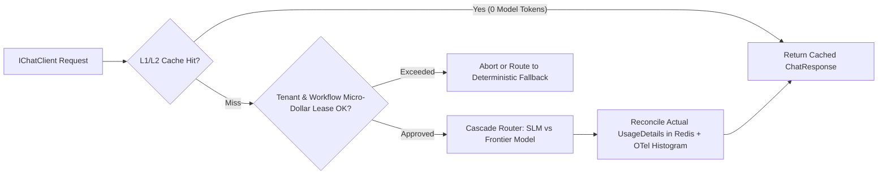

# 05 - Cloud FinOps for AI Workloads

**Navigation:** [[00 - Home MOC]] | [[00 - Quick Start Guide]] | [[00 - Architecture Roadmap]] | [[CLAUDE]]

> [!CAUTION]
> **Real-Time Unit Economics Mandate:** Monthly cloud invoices arrive weeks too late to stop a recursive multi-agent retry storm. Instrument **in-flight micro-dollar accounting** inside your `Microsoft.Extensions.AI` `DelegatingChatClient` pipeline, combining pre-call token leases ([[Concept 01 - Token Budget Leases]]), tiered semantic caching ([[Concept 05 - Tiered Semantic Caching]]), and SLM-to-Frontier model cascades ([[Concept 09 - Model Cascade Routing]]).

---

## 1. Three-Phase FinOps Control Loop

1. **Attribute (Per-Tenant & Per-Workflow):** Every `ChatOptions.AdditionalProperties` bag carries `tenant_id` and `workflow_id`, attributing `InputTokenCount`, `CachedInputTokenCount`, and `OutputTokenCount` in integer micro-dollars (`$1.00 = 1,000,000` micro-dollars) with zero IEEE-754 floating-point drift.
2. **Deflect & Compress:** Intercept identical and high-similarity read queries via `HybridCache` + vector lookup ([[01 - .NET 10 Distributed Foundations]]) and route routine classification/extraction turns to low-cost SLMs before escalating to frontier models.
3. **Trip Deterministically:** Enforce hard per-workflow and per-tenant sliding-window ceilings in Redis/Garnet, throwing `FinOpsBudgetExceededException` (or degrading to a deterministic fallback) before dispatching downstream inference.



---

## 2. Production C# 14 Blueprint: `FinOpsBudgetChatClient` Middleware

Plug this `DelegatingChatClient` directly into `services.AddChatClient(...)` ([[08 - Future-Proofing the AI Stack]]) to enforce per-workflow micro-dollar budgets and emit OpenTelemetry token metrics ([[06 - Observability & Telemetry]]):

```csharp
using System.Collections.Concurrent;
using System.Diagnostics.Metrics;
using Microsoft.Extensions.AI;

namespace ArchVault.DotNet10.FinOps;

public sealed record ModelRateCard(
    long InputMicrosPer1KTokens,
    long CachedInputMicrosPer1KTokens,
    long OutputMicrosPer1KTokens);

public sealed class FinOpsBudgetExceededException(string message) : InvalidOperationException(message);

public sealed class FinOpsBudgetChatClient(
    IChatClient innerClient,
    ModelRateCard rateCard,
    long maxWorkflowMicros = 2_500_000) : DelegatingChatClient(innerClient) // Default ceiling: $2.50 USD / workflow
{
    private static readonly Meter FinOpsMeter = new("ArchVault.FinOps.Metering", "1.0.0");
    private static readonly Histogram<long> TokenHistogram =
        FinOpsMeter.CreateHistogram<long>("gen_ai.client.token.usage", "{token}");
    private static readonly Counter<long> SpendCounter =
        FinOpsMeter.CreateCounter<long>("finops.workflow.spend.micros", "micro_usd");

    // Replace with atomic Redis HINCRBY script in multi-replica clusters
    private readonly ConcurrentDictionary<string, long> _workflowLedgerMicros = new(StringComparer.Ordinal);

    public override async Task<ChatResponse> GetResponseAsync(
        IEnumerable<ChatMessage> messages,
        ChatOptions? options = null,
        CancellationToken cancellationToken = default)
    {
        var workflowId = options?.AdditionalProperties?.TryGetValue("workflow_id", out var wf) == true
            ? wf?.ToString() ?? "unscoped"
            : "unscoped";

        var currentMicros = _workflowLedgerMicros.GetValueOrDefault(workflowId, 0L);
        if (currentMicros >= maxWorkflowMicros)
        {
            throw new FinOpsBudgetExceededException(
                $"Workflow '{workflowId}' breached micro-dollar ceiling ({currentMicros} >= {maxWorkflowMicros}).");
        }

        var response = await base.GetResponseAsync(messages, options, cancellationToken);

        if (response.Usage is { } usage)
        {
            var inTok = usage.InputTokenCount ?? 0L;
            var outTok = usage.OutputTokenCount ?? 0L;
            var cachedTok = usage.CachedInputTokenCount ?? 0L;
            var billableInTok = Math.Max(0L, inTok - cachedTok);

            var callMicros =
                (billableInTok * rateCard.InputMicrosPer1KTokens / 1_000L) +
                (cachedTok * rateCard.CachedInputMicrosPer1KTokens / 1_000L) +
                (outTok * rateCard.OutputMicrosPer1KTokens / 1_000L);

            _workflowLedgerMicros.AddOrUpdate(workflowId, callMicros, (_, prev) => prev + callMicros);

            TokenHistogram.Record(inTok, new KeyValuePair<string, object?>("gen_ai.token.type", "input"));
            TokenHistogram.Record(outTok, new KeyValuePair<string, object?>("gen_ai.token.type", "output"));
            SpendCounter.Add(callMicros);
        }

        return response;
    }
}
```

---

## 3. FinOps Governance Comparison

| Cost Control Vector | Post-Facto Cloud Billing | Real-Time `.NET 10` FinOps Pipeline |
| :--- | :--- | :--- |
| **Attribution Granularity** | Aggregate monthly subscription total | Per-tenant, per-workflow, and per-model via `DelegatingChatClient` |
| **Prompt Caching Leverage** | Unstructured dynamic system prefixes bust provider cache | Static prefix ordering maximizes discounted cached-input tokens |
| **Runaway Retry Containment** | Discovered days later in Azure Cost Management | Stopped mid-flight at `$2.50` (`2,500,000` micro-dollars) |
| **Capacity Planning** | Guesswork spreadsheets | Modeled deterministically in [[Template 02 - Unit Economics Matrix]] |

---

## 4. Connected Architecture, Concepts & Runbooks

- **Runtime & Kernel Producers:** [[01 - .NET 10 Distributed Foundations]] · [[02 - Autonomous AI Agent Topologies]] · [[03 - Semantic Kernel Integration]] · [[04 - Event-Driven AI Orchestration]]
- **Telemetry & Routing Counterparts:** [[06 - Observability & Telemetry]] · [[07 - Scaling Multi-Agent Systems]] · [[08 - Future-Proofing the AI Stack]]
- **Zettelkasten Bridges:** [[Concept 01 - Token Budget Leases]] · [[Concept 05 - Tiered Semantic Caching]] · [[Concept 08 - Dynamic Token Backpressure]] · [[Concept 09 - Model Cascade Routing]]
- **Templates, Prompts & SOPs:** [[Prompt 03 - Unit Economics CFO]] · [[Template 02 - Unit Economics Matrix]] · [[SOP 01 - Weekly Sprint Protocol]] · [[SOP 02 - Bottleneck Audit Matrix]] · [[00 - Visual Blueprint.canvas]]
