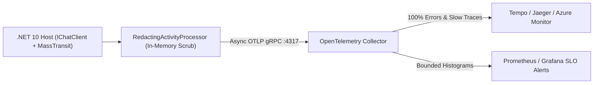

# 06 - Observability & Telemetry

**Navigation:** [[00 - Home MOC]] | [[00 - Quick Start Guide]] | [[00 - Architecture Roadmap]] | [[AGENTS]]

> [!IMPORTANT]
> **Observability Standard:** Standard ASP.NET Core HTTP request spans cannot explain why an autonomous agent chose a tool, looped four times, or breached latency SLOs. Instrument `.NET 10` hosts with **OpenTelemetry GenAI Semantic Conventions (`gen_ai.*`)**, low-cardinality `Meter` histograms, and an **in-process `BaseProcessor<Activity>` PII/secret scrubber** prior to OTLP gRPC export.

---

## 1. Three-Layer Telemetry Architecture in `.NET 10`

1. **Causal Span Hierarchy (`ActivitySource`):** Connects ASP.NET Core / MassTransit root spans (`traceparent`) to `Microsoft.Extensions.AI` chat turns (`Experimental.Microsoft.Extensions.AI`) and Semantic Kernel plugin invocations (`Microsoft.SemanticKernel*`).
2. **Low-Cardinality Metrics (`System.Diagnostics.Metrics.Meter`):** Exports `gen_ai.client.token.usage` and `gen_ai.client.operation.duration` histograms tagged only by bounded dimensions (`gen_ai.request.model`, `gen_ai.operation.name`, `error.type`)—never high-cardinality `workflow_id` or `user_id`!
3. **Compliance Scrubbing Processor:** Redacts bearer tokens, connection strings, and email addresses on `Activity.OnEnd` before any span leaves pod memory.



---

## 2. Production C# 14 Blueprint: `AddAgentOpenTelemetry` + Inline Secret Redactor

```csharp
using System.Diagnostics;
using System.Text.RegularExpressions;
using Microsoft.Extensions.DependencyInjection;
using Microsoft.Extensions.Hosting;
using OpenTelemetry;
using OpenTelemetry.Exporter;
using OpenTelemetry.Metrics;
using OpenTelemetry.Resources;
using OpenTelemetry.Trace;

namespace ArchVault.DotNet10.Observability;

public static partial class AgentObservabilityExtensions
{
    public static readonly ActivitySource RuntimeActivitySource = new("ArchVault.Agent.Runtime", "1.0.0");

    public static IHostApplicationBuilder AddAgentOpenTelemetry(
        this IHostApplicationBuilder builder,
        string serviceName,
        Uri otlpGrpcEndpoint)
    {
        builder.Services.AddOpenTelemetry()
            .ConfigureResource(res => res
                .AddService(serviceName, serviceVersion: "1.0.0")
                .AddAttributes([new KeyValuePair<string, object>("deployment.environment.name", builder.Environment.EnvironmentName)]))
            .WithTracing(tracing => tracing
                .AddAspNetCoreInstrumentation()
                .AddHttpClientInstrumentation()
                .AddSource(RuntimeActivitySource.Name)
                .AddSource("Experimental.Microsoft.Extensions.AI")
                .AddSource("Microsoft.SemanticKernel*")
                .AddSource("ArchVault.*")
                .AddProcessor<SensitiveTagRedactingProcessor>()
                .AddOtlpExporter(otlp =>
                {
                    otlp.Endpoint = otlpGrpcEndpoint;
                    otlp.Protocol = OtlpExportProtocol.Grpc;
                }))
            .WithMetrics(metrics => metrics
                .AddAspNetCoreInstrumentation()
                .AddMeter("System.Runtime") // Native .NET 9/10 CLR OTel meter (dotnet.thread_pool.queue.length, dotnet.gc.pause.time)
                .AddMeter("ArchVault.FinOps.Metering")
                .AddMeter("Experimental.Microsoft.Extensions.AI")
                .AddOtlpExporter(otlp =>
                {
                    otlp.Endpoint = otlpGrpcEndpoint;
                    otlp.Protocol = OtlpExportProtocol.Grpc;
                }));

        return builder;
    }
}

public sealed partial class SensitiveTagRedactingProcessor : BaseProcessor<Activity>
{
    [GeneratedRegex(@"(?i)(bearer\s+[a-z0-9._~+/=-]{16,}|sk-[a-z0-9_-]{16,}|AccountKey=[a-z0-9+/=]{20,})", RegexOptions.CultureInvariant)]
    private static partial Regex CredentialPattern();

    public override void OnEnd(Activity activity)
    {
        foreach (var tag in activity.TagObjects)
        {
            if (tag.Value is string strVal && CredentialPattern().IsMatch(strVal))
            {
                activity.SetTag(tag.Key, CredentialPattern().Replace(strVal, "[REDACTED_SECRET]"));
            }
        }
    }
}
```

---

## 3. Core Production Alerting Thresholds

| Signal | Instrument | Warning / Page Threshold | Triage Runbook |
| :--- | :--- | :--- | :--- |
| **ThreadPool Queue Length** | `dotnet.thread_pool.queue.length` | `> 64` queued work items for `60s` | Audit sync-over-async in [[SOP 02 - Bottleneck Audit Matrix]] |
| **Gen2 GC Pause Ratio** | `dotnet.gc.pause.time` | `> 3%` CPU time in Gen2/LOH collection | Check `HybridCache` payload caps in [[01 - .NET 10 Distributed Foundations]] |
| **LLM Inference `p99` Duration** | `gen_ai.client.operation.duration` | `p99 > 12s` or `429` spike | Engage cascade fallback in [[08 - Future-Proofing the AI Stack]] |
| **Workflow Spend Spike** | `finops.workflow.spend.micros` | Breach rate `> 2 / min` | Inspect loop bounds in [[05 - Cloud FinOps for AI Workloads]] |

---

## 4. Connected Architecture, Concepts & Runbooks

- **Instrumented Subsystems:** [[01 - .NET 10 Distributed Foundations]] · [[02 - Autonomous AI Agent Topologies]] · [[03 - Semantic Kernel Integration]] · [[04 - Event-Driven AI Orchestration]] · [[05 - Cloud FinOps for AI Workloads]]
- **Scale & Portability:** [[07 - Scaling Multi-Agent Systems]] · [[08 - Future-Proofing the AI Stack]]
- **Zettelkasten Bridges:** [[Concept 03 - Event Sourced Agent State]] · [[Concept 06 - GenAI Distributed Tracing]] · [[Concept 09 - Model Cascade Routing]]
- **Prompts & Runbooks:** [[Prompt 02 - Quality Risk Auditor]] · [[Prompt 05 - Root Cause Debug]] · [[SOP 01 - Weekly Sprint Protocol]] · [[SOP 02 - Bottleneck Audit Matrix]] · [[SOP 03 - Scale & Automation Gate]] · [[00 - Visual Blueprint.canvas]]
