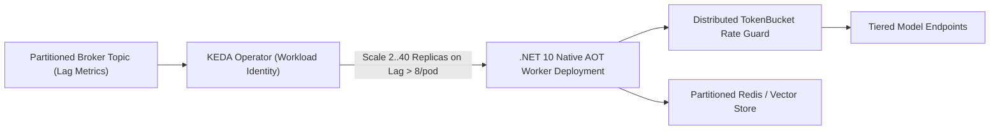

# 07 - Scaling Multi-Agent Systems

**Navigation:** [[00 - Home MOC]] | [[00 - Quick Start Guide]] | [[00 - Architecture Roadmap]] | [[CLAUDE]]

> [!IMPORTANT]
> **Queue-Depth Scaling Law:** AI agent worker pods spend most of their wall-clock execution awaiting asynchronous network I/O from foundation models and vector stores—meaning CPU utilization stays below `15%` even while request queues back up by thousands of messages. Never autoscale agent workers on CPU alone; scale on **partitioned broker queue lag via Kubernetes KEDA** paired with **graceful `SIGTERM` drain budgets**.

---

## 1. Elastic Worker Architecture

1. **Stateless Compute Replicas:** Worker pods store zero cross-turn state on local disk or static dictionaries; checkpoints live in Garnet/Redis or PostgreSQL outbox tables ([[04 - Event-Driven AI Orchestration]]).
2. **Workload-Identity KEDA Triggers:** KEDA inspects Azure Service Bus / Kafka lag using federated Kubernetes Workload Identity (`TriggerAuthentication`—zero connection strings in YAML) and scales `.NET 10` Native AOT pods rapidly ([[Concept 02 - Native AOT Kernel Wiring]]).
3. **Upstream Rate-Limit Awareness:** Cap `maxReplicaCount` relative to your regional model TPM quota and pair each pod with `TokenBucketRateLimiter` backpressure ([[Concept 08 - Dynamic Token Backpressure]]) so scaling out `40` pods does not trigger an instant `HTTP 429` storm.



---

## 2. Production Artifact: KEDA `ScaledObject` + Workload Identity (`keda-agent-worker.yaml`)

```yaml
apiVersion: keda.sh/v1alpha1
kind: TriggerAuthentication
metadata:
  name: azure-servicebus-workload-id
  namespace: ai-workloads
spec:
  podIdentity:
    provider: azure-workload
    identityId: "00000000-0000-0000-0000-000000000000" # Replace with Managed Identity Client ID
---
apiVersion: keda.sh/v1alpha1
kind: ScaledObject
metadata:
  name: dotnet10-agent-worker-scaler
  namespace: ai-workloads
spec:
  scaleTargetRef:
    apiVersion: apps/v1
    kind: Deployment
    name: dotnet10-agent-worker
  pollingInterval: 10
  cooldownPeriod: 180
  minReplicaCount: 2
  maxReplicaCount: 40
  advanced:
    horizontalPodAutoscalerConfig:
      behavior:
        scaleDown:
          stabilizationWindowSeconds: 180
          policies:
            - type: Percent
              value: 25
              periodSeconds: 60
  triggers:
    - type: azure-servicebus
      metadata:
        namespace: sb-archvault-prod
        topicName: agent-workflow-steps
        subscriptionName: step-executor
        messageCount: "8"
        activationMessageCount: "1"
      authenticationRef:
        name: azure-servicebus-workload-id
```

---

## 3. Graceful `SIGTERM` Drain Configuration in `.NET 10`

When KEDA scales down replicas after a burst, Kubernetes sends `SIGTERM`. Configure `HostOptions.ShutdownTimeout` (`>= 45s`) and `terminationGracePeriodSeconds: 60` on the Pod spec so in-flight LLM completions checkpoint cleanly before process exit:

```csharp
using Microsoft.Extensions.DependencyInjection;
using Microsoft.Extensions.Hosting;

namespace ArchVault.DotNet10.Scaling;

public static class GracefulDrainHostingExtensions
{
    public static IHostApplicationBuilder ConfigureGracefulAgentDrain(this IHostApplicationBuilder builder)
    {
        builder.Services.Configure<HostOptions>(options =>
        {
            // Allow active LLM turns to finish & flush OTel/Outbox before SIGKILL
            options.ShutdownTimeout = TimeSpan.FromSeconds(45);
            options.ServicesStartConcurrently = true;
            options.ServicesStopConcurrently = true;
        });

        return builder;
    }
}
```

---

## 4. Connected Architecture, Concepts & Runbooks

- **Upstream Runtime & Messaging:** [[01 - .NET 10 Distributed Foundations]] · [[02 - Autonomous AI Agent Topologies]] · [[04 - Event-Driven AI Orchestration]]
- **Cost, Telemetry & Multi-Provider Routing:** [[05 - Cloud FinOps for AI Workloads]] · [[06 - Observability & Telemetry]] · [[08 - Future-Proofing the AI Stack]]
- **Zettelkasten Bridges:** [[Concept 04 - Ephemeral Swarm Allocation]] · [[Concept 07 - Speculative Tool Execution]] · [[Concept 08 - Dynamic Token Backpressure]] · [[Concept 10 - Tenant Memory Isolation]]
- **Prompts & Runbooks:** [[Prompt 01 - System Architect]] · [[Prompt 06 - Production Readiness & Chaos Review]] · [[Template 03 - Production Release Playbook]] · [[SOP 02 - Bottleneck Audit Matrix]] · [[SOP 03 - Scale & Automation Gate]] · [[00 - Visual Blueprint.canvas]]
