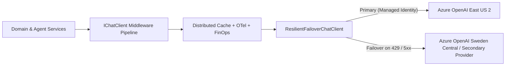

# 08 - Future-Proofing the AI Stack

**Navigation:** [[00 - Home MOC]] | [[00 - Quick Start Guide]] | [[00 - Architecture Roadmap]] | [[AGENTS]]

> [!IMPORTANT]
> **Anti-Lock-In Architecture Rule:** Foundation model checkpoints deprecate every few quarters, pricing tiers shift, and regional cloud endpoints experience brownouts. Isolate 100% of domain and agent logic behind **`Microsoft.Extensions.AI` (`IChatClient` and `IEmbeddingGenerator`)**, authenticate via **`DefaultAzureCredential` (zero hardcoded API keys)**, and compose cross-provider failover in Dependency Injection.

---

## 1. Three Decoupling Boundaries

1. **Unified Inference Contract (`IChatClient`):** Application code depends strictly on `Microsoft.Extensions.AI.Abstractions`, allowing configuration-driven hot-swapping between Azure OpenAI, OpenAI, Anthropic, and self-hosted Ollama/vLLM containers.
2. **Zero-Secret Cloud Authentication:** Use `Azure.Identity.DefaultAzureCredential` so local developers authenticate via Azure CLI / Visual Studio while production pods use federated Managed Identity—never `AzureKeyCredential` strings in config files ([[CLAUDE]]).
3. **Resilient Primary-to-Fallback Failover:** Wrap primary regional endpoints in a `FallbackChatClient` that automatically fails over to a secondary region or provider upon `HttpRequestException`, `429 Too Many Requests`, or `5xx` outages.



---

## 2. Production C# 14 Blueprint: Managed-Identity `IChatClient` + Failover Pipeline

```csharp
using System.Net;
using Azure.AI.OpenAI;
using Azure.Identity;
using Microsoft.Extensions.AI;
using Microsoft.Extensions.Configuration;
using Microsoft.Extensions.DependencyInjection;
using Microsoft.Extensions.Logging;

namespace ArchVault.DotNet10.Portability;

public static class PortableAiStackRegistration
{
    public static IServiceCollection AddPortableEnterpriseChatClient(
        this IServiceCollection services,
        IConfiguration configuration)
    {
        var primaryEndpoint = new Uri(configuration["AiStack:PrimaryEndpoint"]
            ?? throw new InvalidOperationException("Missing AiStack:PrimaryEndpoint."));
        var primaryDeployment = configuration["AiStack:PrimaryDeployment"] ?? "gpt-5-mini";

        var secondaryEndpoint = new Uri(configuration["AiStack:SecondaryEndpoint"]
            ?? throw new InvalidOperationException("Missing AiStack:SecondaryEndpoint."));
        var secondaryDeployment = configuration["AiStack:SecondaryDeployment"] ?? primaryDeployment;

        var credential = new DefaultAzureCredential();

        IChatClient primaryClient = new AzureOpenAIClient(primaryEndpoint, credential)
            .GetChatClient(primaryDeployment)
            .AsIChatClient();

        IChatClient fallbackClient = new AzureOpenAIClient(secondaryEndpoint, credential)
            .GetChatClient(secondaryDeployment)
            .AsIChatClient();

        services.AddChatClient(sp =>
        {
            var logger = sp.GetRequiredService<ILoggerFactory>().CreateLogger("AiFailover");
            IChatClient resilientRoot = new ResilientFailoverChatClient(primaryClient, fallbackClient, logger);

            return new ChatClientBuilder(resilientRoot)
                .UseFunctionInvocation()
                .UseOpenTelemetry(sourceName: "Experimental.Microsoft.Extensions.AI")
                .Build(sp);
        });

        return services;
    }
}

public sealed class ResilientFailoverChatClient(
    IChatClient primary,
    IChatClient secondary,
    ILogger logger) : DelegatingChatClient(primary)
{
    public override async Task<ChatResponse> GetResponseAsync(
        IEnumerable<ChatMessage> messages,
        ChatOptions? options = null,
        CancellationToken cancellationToken = default)
    {
        var materialized = messages as IList<ChatMessage> ?? messages.ToList();
        try
        {
            return await base.GetResponseAsync(materialized, options, cancellationToken);
        }
        catch (Exception ex) when (IsFailoverEligible(ex) && !cancellationToken.IsCancellationRequested)
        {
            logger.LogWarning(ex, "Primary AI endpoint degraded; failing over to secondary region/provider.");
            return await secondary.GetResponseAsync(materialized, options, cancellationToken);
        }
    }

    private static bool IsFailoverEligible(Exception ex) =>
        ex is HttpRequestException { StatusCode: HttpStatusCode.TooManyRequests or >= HttpStatusCode.InternalServerError }
        or TaskCanceledException;
}
```

---

## 3. Migration & Model-Upgrade Discipline

> [!TIP]
> **Shadow Canary Evaluation:** Before promoting a new model checkpoint (`AiStack:PrimaryDeployment`), replay your golden xUnit + trace fixture suite ([[Prompt 04 - Verification Gate]] and [[SOP 03 - Scale & Automation Gate]]) to verify tool-schema compliance and latency budgets before shifting live tenant traffic.

---

## 4. Connected Architecture, Concepts & Runbooks

- **Core Foundations & Kernel:** [[01 - .NET 10 Distributed Foundations]] · [[02 - Autonomous AI Agent Topologies]] · [[03 - Semantic Kernel Integration]] · [[04 - Event-Driven AI Orchestration]]
- **Operations & Elastic Scale:** [[05 - Cloud FinOps for AI Workloads]] · [[06 - Observability & Telemetry]] · [[07 - Scaling Multi-Agent Systems]]
- **Zettelkasten Bridges:** [[Concept 01 - Token Budget Leases]] · [[Concept 08 - Dynamic Token Backpressure]] · [[Concept 09 - Model Cascade Routing]]
- **Prompts, Templates & SOPs:** [[Prompt 02 - Quality Risk Auditor]] · [[Prompt 04 - Verification Gate]] · [[Template 01 - ADR Decision Record]] · [[Template 03 - Production Release Playbook]] · [[SOP 03 - Scale & Automation Gate]] · [[00 - Visual Blueprint.canvas]]
