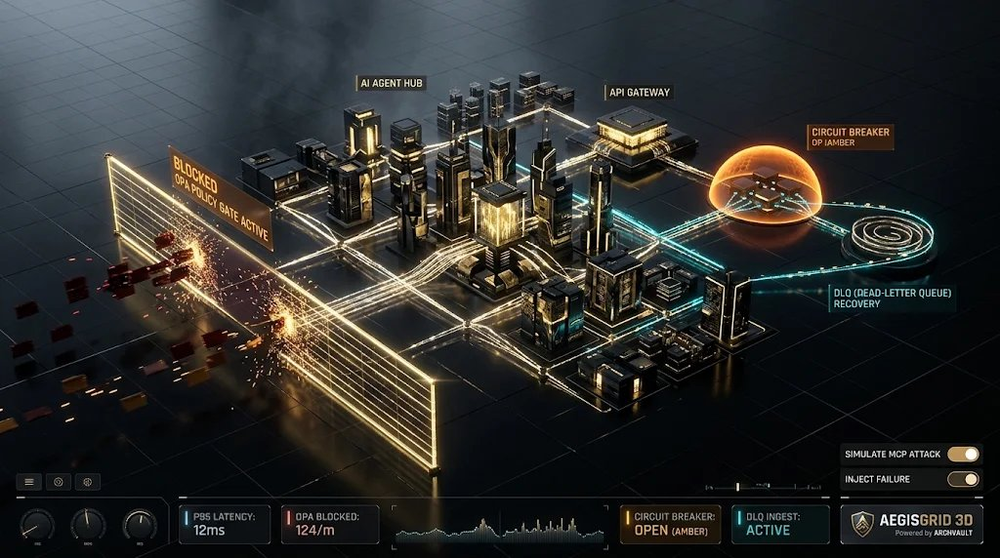
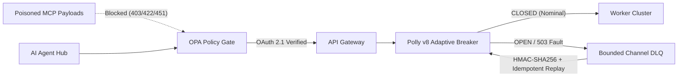

# AegisGrid 3D — Live `.NET 10` Architecture Digital Twin

<p align="center">
  <a href="https://github.com/KennerGV/aegisgrid-3d/actions/workflows/deploy.yml">
    
  </a>
</p>

<p align="center">
  
</p>

<p align="center">
  <a href="https://kennergv.github.io/aegisgrid-3d/"><strong>Launch Live 3D WebGL Demo</strong></a> ·
  <a href="https://archvaults.dev"><strong>ArchVault Official</strong></a> ·
  <a href="https://archvaults.dev/visor"><strong>Explore Interactive 3D Graph Visor</strong></a> ·
  <a href="https://whop.com/archvault-dev/"><strong>Download Free $0 Starter Vault on Whop</strong></a>
</p>

---

**AegisGrid 3D** is the flagship open-source live architecture showcase for **[ArchVault](https://archvaults.dev)**. Instead of static boxes-and-arrows slides, AegisGrid 3D pairs a compiler-gated **`.NET 10` Native-AOT-compatible** microservice resilience engine with a locked-60-FPS **WebGL (`THREE.InstancedMesh`)** isometric digital twin—complete with live chaos injection, deterministic **OPA MCP tool guardrails**, **Polly v8 adaptive circuit breaking**, and **HMAC-verified Dead-Letter Queue (DLQ) replay**.

> [!IMPORTANT]
> **Interactive Browser Demo vs. Live `.NET 10` Backend Mode**
> - **Hosted Live Demo ([`kennergv.github.io/aegisgrid-3d`](https://kennergv.github.io/aegisgrid-3d/)):** Runs 100% in **standalone client-side simulation mode (`LOCAL SIMULATOR`)** directly in your browser so every visitor gets a private, isolated 60 FPS sandbox to test chaos scenarios (`SIMULATE MCP ATTACK`, `INJECT FAILURE`, `REPLAY DLQ`) with zero multi-user interference.
> - **Full `.NET 10` Live Engine (`.NET 10 SSE LIVE`):** To see the real C# 14 / `.NET 10` backend in action—executing Polly v8 adaptive circuit breakers, `OpaPolicyEvaluator`, constant-time `HmacWebhookVerifier`, and bounded `System.Threading.Channels` over real-time `150ms` UTF-8 Server-Sent Events—clone this repository and start both `backend` and `frontend` locally below. Every commit to `main` automatically verifies the `.NET 10` Release & Native-AOT compiler gate via GitHub Actions.

---

## Run Locally (Full `.NET 10` Live Engine + 3D WebGL Twin)

### Option A: Bare-Metal Local Dev (`.NET 10 SDK` + `Node 22+`)

```bash
git clone https://github.com/KennerGV/aegisgrid-3d.git
cd aegisgrid-3d

# Terminal 1 — Start the compiler-gated .NET 10 resilience API on :5000
dotnet run --project backend/AegisGrid.Api/AegisGrid.Api.csproj -c Release

# Terminal 2 — Launch the React Three Fiber 3D twin on :3000
cd frontend
npm install
npm run dev
```

Open **`http://localhost:3000`**. The top-left HUD badge automatically switches to green **`.NET 10 SSE LIVE`**, streaming real-time `150ms` telemetry frames directly from Kestrel.

### Option B: Docker Compose (1-Command Startup)

```bash
docker compose up --build
```

---

## Live Architecture & Interactive Chaos Scenarios



Use the bottom-right glassmorphic HUD controls in the 3D scene (or `curl` directly against `:5000` when running locally) to test fault-isolation invariants in real time:

1. **`SIMULATE MCP ATTACK` (`POST /api/chaos/mcp-attack`):**
   Fires a 12-second volley of poisoned Model Context Protocol tool calls (`drop_table`, AWS/GCP metadata SSRF `169.254.169.254`, unauthorized egress `exfil-shadow-c2.io`, and missing `mcp:tools:invoke` OAuth 2.1 scopes). Watch crimson attack shards slam into the gold **OPA Policy Gate** and erupt into deflection sparks while `OPA BLOCKED/M` surges.
2. **`INJECT FAILURE` (`POST /api/chaos/inject-failure`):**
   Injects downstream `HTTP 503` degradation. Polly v8 executes jittered exponential retries, crosses `FailureRatio = 0.5`, trips the circuit breaker to **`OPEN` (`BreakDuration = 10s`)**, encapsulates the Worker Cluster inside a translucent amber energy dome, and diverts in-flight envelopes into the glowing cyan **Bounded Channel DLQ**.
3. **`REPLAY DLQ` (`POST /api/chaos/replay-dlq`):**
   Recovers the downstream cluster and drains buffered dead-letter envelopes in paced micro-batches—verifying every payload with constant-time `HMAC-SHA256` (`CryptographicOperations.FixedTimeEquals`) and enforcing atomic exactly-once execution via `ConcurrentDictionary<string, DateTimeOffset>` idempotency keys.

---

## Compiler-Gated Governance via `.agent/skills/archvault-dotnet-starter/`

This repository demonstrates **ArchVault's Dual-Mode Engineering Workflow**: the exact same Markdown constellation inside [`.agent/skills/archvault-dotnet-starter/`](.agent/skills/archvault-dotnet-starter/SKILL.md) opens in **Obsidian** as a visual architecture graph *and* governs AI coding agents (**Claude Code, Cursor, GitHub Copilot, Codex, Google Antigravity**) via root [`AGENTS.md`](AGENTS.md).

Every build enforces strict `.NET 10` compiler and ILLink trim/AOT gates:

```bash
# Gate 1: Zero warnings, nullable reference enforcement & Native-AOT trim analysis
dotnet build backend/AegisGrid.Api/AegisGrid.Api.csproj -c Release -warnaserror

# Gate 2: Strict TypeScript & Vite production bundle verification
cd frontend && npm run build
```

### Enforced Architectural Invariants

- **Zero Reflection Serialization (`AegisGridJsonContext.cs`):** All JSON responses and 150ms UTF-8 SSE frames use compile-time `JsonSerializerContext` source generation (`<IsAotCompatible>true</IsAotCompatible>`, `<EnableTrimAnalyzer>true</EnableTrimAnalyzer>`, `<EnableRequestDelegateGenerator>true</EnableRequestDelegateGenerator>`).
- **Zero Unbounded Queues (`DlqRecoveryWorker.cs`):** Enforces `Channel.CreateBounded<DeadLetterEnvelope>(2048)` with `AllowSynchronousContinuations = false`—eliminating heap exhaustion and Kestrel thread-pool hijacking.
- **Constant-Time Webhook Security (`HmacWebhookVerifier.cs`):** Computes canonical timestamp-bound `HMACSHA256` digests on `stackalloc` buffers and verifies them with `CryptographicOperations.FixedTimeEquals`.
- **Integrated-GPU 60 FPS Budget (`PacketStreams.tsx`):** Pre-bakes `CatmullRomCurve3` lookup tables into `Float32Array` buffers and drives hundreds of animated spline packets via `THREE.InstancedMesh` matrix updates with selective HDR luminance bloom (`luminanceThreshold = 1.06`).

---

## Governing ArchVault Blueprints

Click the **`AEGISGRID 3D — Powered by ARCHVAULT`** crest in the bottom-right HUD (or any floating 3D subsystem label) to inspect how each live module maps to its ArchVault specification:

| AegisGrid 3D Subsystem | Governing ArchVault Package | Availability |
| :--- | :--- | :--- |
| **`.NET 10` Native AOT Core & Bounded Channels** | **Blueprint Starter .NET 10** (`37` connected Obsidian notes, `.canvas` board & agent skill) | **Free (`$0`)** — bundled in [`.agent/skills/archvault-dotnet-starter/`](.agent/skills/archvault-dotnet-starter/SKILL.md) & on [Whop](https://whop.com/archvault-dev/) |
| **OPA Policy Gate & MCP Shield** | **Enterprise MCP Server Gateway, OAuth 2.1 Delegation & OPA Tool Guardrails** | Production Vault — [Preview in Visor](https://archvaults.dev/visor) · [Get on Whop](https://whop.com/archvault-dev/) |
| **Adaptive Circuit Breaker & DLQ Spiral** | **Cryptographic Webhook Delivery, Adaptive Circuit Breakers & DLQ Replay** | Production Vault — [Preview in Visor](https://archvaults.dev/visor) · [Get on Whop](https://whop.com/archvault-dev/) |

---

## Explore ArchVault

- **Live 3D WebGL Demo:** [https://kennergv.github.io/aegisgrid-3d/](https://kennergv.github.io/aegisgrid-3d/)
- **Interactive Constellation Graph Visor:** [https://archvaults.dev/visor](https://archvaults.dev/visor)
- **Download the Free `$0` `.NET 10` Starter Vault & Pro Blueprints:** [https://whop.com/archvault-dev/](https://whop.com/archvault-dev/)
- **ArchVault Platform:** [https://archvaults.dev](https://archvaults.dev)
